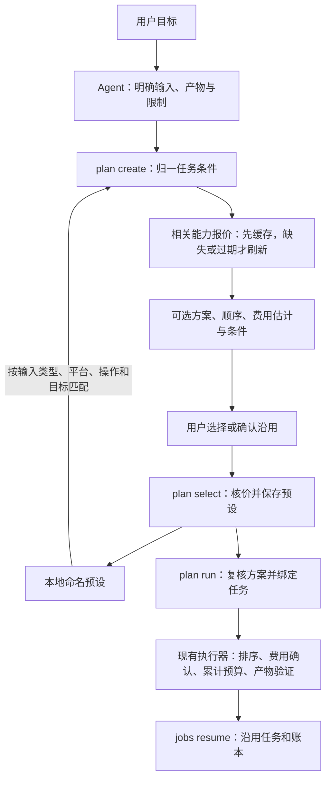

# 目标规划与预设

用户用自然语言说出目标，Agent 按 Soota Skill 整理输入、目标产物和限制，再调用 `plan create`。程序给出免费、当前排序与预算、适用的指定来源方案；用户选择后，`plan select --confirm` 保存命名预设，`plan run` 创建采集任务。



自然语言理解和确认对话由 Agent 完成，CLI 不调用模型。预设匹配是结构匹配：平台、输入类型、本地文件类型、原生操作及是否展开、必需/可选产物相同才列为候选；不同链接和不同输入数量可复用。它不是语义相似度搜索。匹配成功不代表用户已经同意执行。

## 首次选择

以下 URL、ID、路径和预算为示例，替换为本次实际值：

```bash
soota plan create "视频 URL" --goal "保存原字幕和原文" \
  --want transcript,context --transcript captions-only --max-cost 0.05 --json

# 用户从返回的 options 选定后：
soota plan select PLAN_ID --option configured --confirm --save-as "视频原字幕" --json
soota plan run PLAN_ID --json
```

`--option` 使用返回的真实 ID，例如 `free`、`configured`、`provider:treg` 或 `preset:视频原字幕`。指定来源方案仅在已启用且覆盖所需能力时提供；命令不自动启用来源、配置凭据或提高费用权限。`--save-as` 默认使用所匹配的预设名称，首次保存则使用目标说明。已有同名预设不会被无条件覆盖；通过匹配方案更新时核对版本，或使用新名称保存。

`plan create` 接受 `--inputs-file`、`--operation/--param/--expand`、`--optional`、语言、字幕格式、并发、媒体限制、预算和来源参数。`--want` 必填，只有 Soota 的七种采集目标；文章写作、分析、导出和知识交付由 LoreLab 接续。`--audio-provider` 沿用现有含义，选择字幕转写所需音频的来源；独立 `--want audio` 的来源仍由 `--provider` 和 audio 排序规则决定。

## 下次使用

```bash
soota plan create "另一条视频 URL" --goal "保存字幕" \
  --want transcript,context --json
```

匹配时返回 `awaiting_preset_confirmation`、候选预设及 `changes`。Agent 展示旧偏好、本次费用估计和显式参数造成的差异，询问是否沿用。确认后才能执行：

```bash
soota plan select NEW_PLAN_ID --option "preset:视频原字幕" --confirm --json
soota plan run NEW_PLAN_ID --json
```

没有 `--confirm` 的 select 只返回 `confirmation_required`，不保存；没有已确认选择的 run 同样不执行。若报价、可用来源、账户地址或费用策略在选择/运行前变化，返回 `plan_changed` 并清除选择，先展示当前方案再重新选择。旧预设不会因查看或失败确认而被改写。

本次明确的语言、字幕模式、来源等条件覆盖旧偏好；本次与旧预设的美元/credits 上限取更小值。需要扩大额度时选本次新方案，不用旧预设偷偷扩大授权。当前已停用的来源始终保持停用；在预设保存后新启用的来源也不会自动加入旧预设。费用确认仍由当前 `policy` 控制，选择方案不等于打开自动付款。

## 报价的触发方式

这是**需求触发、自动按需查询**：

- create 对本次任务相关能力查价，优先复用有效缓存；select 和 run 核对当前报价，过期/缺失才刷新。一次规划的多个方案共用查询结果。
- `plan create --offline` 只读本地估计；确认前仍核对有效报价。`plan show` 与 `presets list/show` 不联网。
- `--max-cost 0` 的本次方案不查询计费来源；过期时间流逝本身不触发任何请求。没有后台轮询或全目录扫价。

`quoted_steps_usd` 是必需步骤首选来源的报价小计，不是最终账单。条件音频、可选产物和候选来源分别列在 `routes`；Weir credits 单独显示。目录显示每页报价和 `request_limit`，频道别名解析另列，未枚举条目的费用未知。旧包补取、JSON 媒体描述、本地运行时、网站登录和实际产物尚未验证时保留相应 `coverage`。原生接口仅凭价格不能承诺正文/媒体，必需产物缺少已核实转换绑定时方案不可选。

执行先完成整批必需目标及其依赖，再用剩余额度尝试可选产物。必需阶段有条目失败时跳过可选获取，保留错误和剩余预算；不会在同一次运行中为进入可选阶段自动重试失败请求。恢复仍沿用原账本与已验证产物。

有效缓存命中通常很快；首次或过期报价需要等待网络响应。预览不调用计费采集、不检查付费余额、不枚举网站内容，也不把未知价格当作零。运行时仍逐请求执行费用确认和持久预算预留；报价失败会阻止付费方案。

## 保存与恢复

- `config_dir/presets.json`：版本化命名预设，只保存采集偏好、路由规则和允许来源；不保存输入 URL、输出路径、凭据、旧报价、已花费用或任务 ID。单条视频的过滤区间不复用到下一条视频。
- `data_dir/plans/PLAN_ID/plan.json`：私有单次规划，包含本次输入和输出路径、可选方案、已确认选择、采集任务 ID。文件限制为当前用户读写，仍需核对所在目录自身的 Git/同步规则。
- 选择的路由偏好写入 TaskSpec，执行和恢复共用相同策略；当前停用和费用控制继续生效。采集缓存身份包含该偏好，避免把不同指定来源的结果当作相同采集条件。
- `plan run` 在首个采集请求前保存任务绑定。再次 run 返回已有 `job_id`，不会新建任务和账本；用 `jobs resume JOB_ID` 继续。目录子任务也在请求前保存关联。新输入重新 create，取得新任务和预算；恢复旧任务不清零已预留费用。

```bash
soota plan show PLAN_ID --json
soota presets list --json
soota presets show "视频原字幕" --json
soota presets delete "视频原字幕" --json
```

原有 `ingest` 和离线 `--dry-run` 接口保持可用，不自动创建规划或命名预设。命令级回归涵盖本地完整选择/复用/执行、报价 TTL、费用策略变化、预算与恢复；这些验证不代表已用真实付费账号完成网站采集验收。
