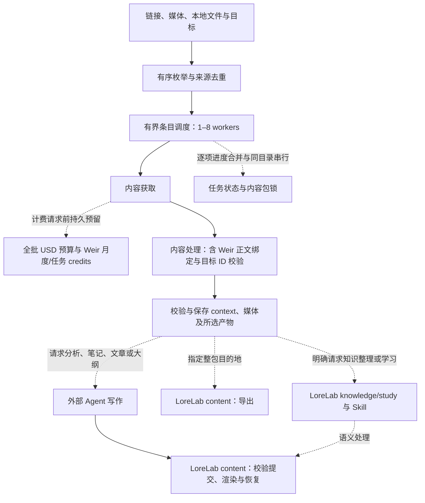
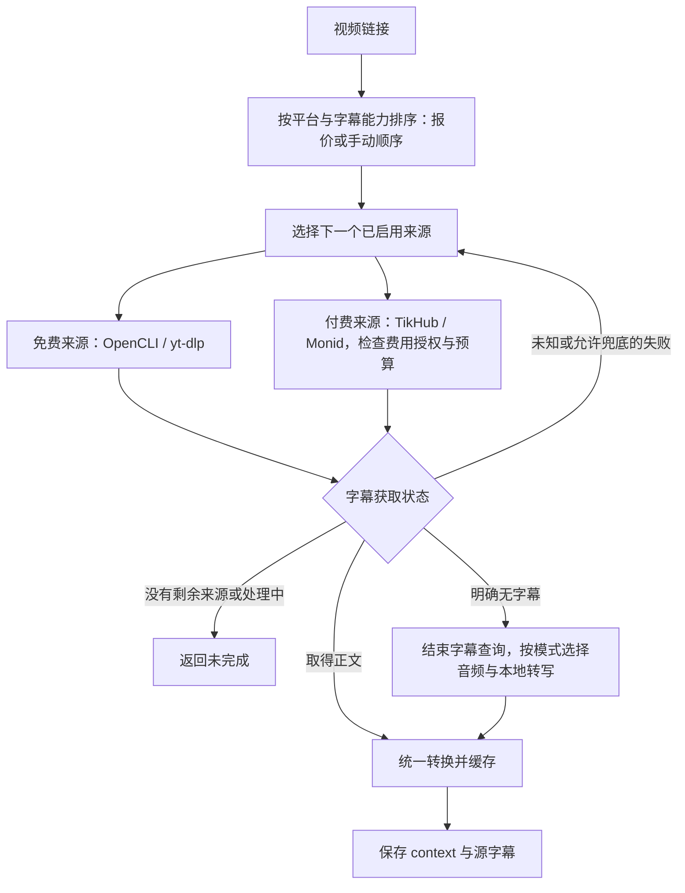

# Provider 与独立运行时

## Windows 运行

核心导入不要求 Unix 的 `fcntl` 或 `resource`。`storage/locking.py` 在 Unix 使用 `flock`，在 Windows 使用 `LockFileEx`，保留共享／排他、等待／立即失败语义；任务互斥、全批预算和运行时更新锁都使用真实内核锁。预算的请求前持久预留与恢复规则不变。

`platform_support.py` 处理虚拟环境入口、npm 包入口和 UTF-8。Windows 虚拟环境使用 `Scripts/python.exe`；OpenCLI、opencli-mcp 与 npm 的 `.cmd` 入口从已安装包的 `bin` 元数据解析为 `node + JS`，参数不拼接到 shell。自定义批处理入口会明确拒绝，可配置 `.exe` 或 Node.js 脚本。独立 Soota 无需 LoreLab 平台模块。

`providers/process_pipes.py` 在 Windows 并发写 stdin、读 stdout/stderr，合计输出上限不变；`windows_process.py` 先将等待派发的进程放入 Job Object，再启动实际命令。超时、超限、取消和失败会清理其子进程树；无法建立保护时不派发。成功的 daemon 启动允许后台服务继续运行。Unix 保留 selector 和进程组逻辑。

Windows 没有这里所需的 `RLIMIT_FSIZE` 等价接口。需要硬文件字节上限的外部 yt-dlp 媒体下载（含 HLS/DASH）、FFmpeg 提取和合轨在派发前返回 `file_limit_unavailable`；不采用轮询文件大小或提示性的 `--max-filesize` 冒充硬上限。直接 HTTP 文件下载在写入前逐块检查上限；已有文件验证、字幕和正文路径仍可使用。调用方不得静默删掉必需媒体目标或绕过预算继续执行。

Downie、macOS Keychain 和 Apple Silicon MLX 是可选 Mac 功能，不能阻止 Windows 导入。Windows 使用环境变量提供 TikHub Key。当前回归含本地子进程、锁竞争、模拟 Windows 分支及 Windows 内核专用测试；在 macOS 上通过不代表已完成真实 Windows、浏览器登录或网站验收。

## 处理流程与职责

这张图按职责展示 Soota 的采集、处理、产物与恢复。每个框包含内部的工具、格式和失败处理；只有请求的目标需要某一步时才执行它。默认文字采集到 context 结束，媒体目标直接交付文件。语义产物和导出由外部 LoreLab content 执行，知识整理和学习复习分别由明确请求触发。



| 黑盒 | 职责 | 代码入口 |
| --- | --- | --- |
| 输入与目标 | 识别链接、本地文件、清单与旧内容包，声明必需和可选产物 | `tasks/entry.py`、`tasks/inputs.py`、`tasks/models.py` |
| 采集任务编排 | 有序枚举与去重；有界条目并行，同目录串行；传播上下文，锁内合并进度，复用产物，中断收尾；全批请求前预留 | `tasks/runner.py`、`tasks/scheduler.py`、`tasks/enumeration.py`、`tasks/state.py`、`storage/task_budget.py`、`storage/credit_budget.py` |
| 内容获取 | 按能力选择 Provider，取得原生数据、正文、字幕或媒体；保留真实获取状态 | `providers/`、`content/native.py`、`tasks/acquire.py` |
| 内容处理 | 字幕格式统一、本地转写、正文结构转换及媒体处理；默认不做语义改写 | `transcripts/`、`content/`、`media/` |
| 校验与保存产物 | 校验文件与媒体，登记 v2 产物、来源及校验值，保护既有源文和文章 | `media/probe.py`、`artifacts/bundle.py` |
| 外部语义处理 | Agent 阅读与写作；LoreLab 校验正文指纹、task/item 身份与证据，保存语义产物 | `lorelab content ingest/resume/render`，LoreLab Skill |
| 外部整包导出 | 写入指定目录，维持相对附件链接并检查人工修改冲突 | `lorelab content export` |

[统一任务契约](tasks.md)维护采集输入、原文产物和恢复；语义提交、渲染与导出以及知识文章、学习交付由外部 LoreLab 维护，见[迁移说明](knowledge.md)。职责、阶段顺序或能力改变时，同步更新本图、受影响的表和对应 Skill；不以未来目标代替当前实现。

LoreLab 接收 Soota 内容包并通过 Cubox、幕布各自的 CLI 组织知识交付。独立 Soota 不包含该工作流，也不要求安装 LoreLab。采集任务的并行、预算、缓存和恢复继续属于 Soota；语义目标、提交校验、渲染、导出、知识审阅、单写入者、交付回读和清理属于 LoreLab。旧语义或交付调用仅作隐藏兼容转发，缺少 LoreLab 时在修改任务前停止。正文可用、任务完成或 hash 正确均不证明原始来源完整，语义判断仍由 Agent 负责。单元/契约测试不代表真实站点或收藏批次已验收。

### 字幕边界

`pipeline.py` 和 `transcripts/resolver.py` 负责流程编排；`transcripts/acquisition.py` 串联获取、转换与验证后的缓存。Provider 返回 `CaptionAcquisition`：获取状态、轨道信息以及带格式标识的原始 `CaptionPayload`，不生成 `TranscriptSegment`。转换层不调用 Provider、不联网、不选取获取优先级；格式相同的正文共享同一解析器。

获取成功只表示拿到了正文。转换成功且存在有效片段后，才保存可复用的字幕缓存并作为可用字幕继续处理。旧片段缓存以显式 `soota-segments` 输入经过同一转换入口；读取缓存不延长其原始有效期。正文缓存不采用日志用的 URL 脱敏，避免破坏字幕里的文字；请求记录仍按原规则脱敏，不缓存访问凭据或签名字幕下载地址。

格式能力、解析限制和新增格式的位置以 [字幕格式与 context](subtitle-formats.md#统一转换层) 为准；获取工具顺序与格式获取偏好都属于内容获取黑盒。

字幕路径按平台及能力的费用或手动规则排序，免费来源默认优先，可选 Monid 与 TikHub 均受费用策略约束；媒体、正文和原生数据分别使用对应能力，不能将同一个排序套用于所有步骤。MCP 默认停用。显式来源严格保留，获取失败不会自动重新从其他 Provider 获取。业务入口见 [功能入口与费用策略](features.md)，组合任务和能力发现见 [统一内容任务](tasks.md)。

## Weir 正文来源

`providers/weir.py` 获取原始单项数据并执行免费余额检查；`content/weir.py` 核对帖子/Article 身份、确定性绑定全文并写入有效缓存；`storage/credit_budget.py` 负责跨任务月度与任务累计 credits 的锁内预留和核账。它们复用统一任务/原文包，不包含语义生成。配置、能力和边界见 [Weir](weir.md)。

## 当前接入范围

| 能力 | OpenCLI | TikHub |
| --- | --- | --- |
| Bilibili / YouTube 元数据与字幕 | 优先；轨道类型与真实语言未标明时保留未知 | 显式选择或经授权兜底 |
| B站同作者同一期 YouTube 字幕优先 | 可选 `--prefer-youtube`，有频道和同一期视频依据才替换 | 未接入 |
| X 用户最近帖子 | 最多 200 条快照，完整性未知 | 统一目录解析尚未接入，可用 `api call` 获取原始响应 |
| YouTube 频道 / Bilibili UP 主目录 | 未接入可续跑分页 | 保留分页、预算、检查点与续跑 |
| 音频、本地 ASR 流程 | 音频独立选择 yt-dlp（默认）或 Downie（显式） | 显式音频来源；受费用策略控制 |
| 网页与文章正文 | 已绑定网页、微信、知乎、X 文章及小红书正文结果；依赖当前运行时命令 | 原生 API 数据，未通用映射为文章正文 |
| 独立媒体产物 | 已绑定小红书、X、Bilibili 原生下载结果，由共享服务验证 | 统一音频能力；视频分轨需显式媒体描述，不能猜测返回字段 |

同一 Provider 内先查缓存。显式 `--provider` 严格选择指定来源，除非同时指定已支持的 fallback。字幕跨平台选择及推广过滤见 [字幕选择与过滤](subtitle-selection.md)。

共享 `media/` 还接收本地文件、直接媒体地址、HLS/DASH、分离音视频地址及 yt-dlp 页面提取结果，完成文件获取和验证。下载器能读取某个媒体，不等于该平台已经拥有标准字幕、正文或集合解析。

`capabilities` 从当前运行时清单和受控注册表区分 `discovered`、`native`、`standard`、`blocked`；不会自动标记真实站点 `verified`。`api list/show` 使用受控 TikHub 注册表；`api call` 可按规则使用直连 TikHub 或已启用的 Monid 转发。OpenCLI 自带命令只有经过结果绑定后才进入对应的标准正文、媒体或列表流程。

### yt-dlp Provider

使用 `--provider yt-dlp` 显式选择。旧 `--provider soota`、旧默认来源配置和未过期的 YouTube 缓存仍可读取；新输出统一标记 `yt-dlp`。Soota 程序名和 `SOOTA_YTDLP_*` 环境变量不变。

支持 YouTube/Bilibili 单视频元数据和字幕，通过外部 yt-dlp 执行。`inspect`、`ingest`、`youtube.video.detail` 和 `bilibili.video.detail` 按能力使用它；同时支持转写用的音频下载。统一任务的媒体页面提取和 YouTube 播放列表枚举另外复用 yt-dlp；这些入口不扩张该字幕适配器的双平台契约。B 站当前使用默认分 P。`official` 表示网站的非自动字幕轨道，不保证作者上传前未使用 AI。

B 站 `ai-*` 轨道归为自动字幕；弹幕不作为字幕。登录提示会报错停止，不冒充“没有字幕”，也不触发付费兜底。

字幕优先匹配请求语言，其次同语系；同一语言匹配级别优先非自动轨道。没有匹配语言时选择其他现有轨道，输出记录实际语言和轨道类型。不保存签名字幕 URL、请求头或 Cookie；根据所选轨道实际提供的格式，依次选择 JSON3、VTT、TTML、SRV3、SRV2、SRV1、SRT、XML、TXT 中的一份；转换不遍历其他格式。B 站通常提供 SRT。临时文件读取为原始正文后删除，正文交给统一转换层。缓存按程序路径、浏览器选择和请求语言的散列隔离，保留 300 秒；同一 profile 切换账号后需使用新的缓存目录。

`SOOTA_YTDLP_BINARY` 指定程序，默认 PATH 中的 `yt-dlp`；`SOOTA_YTDLP_COOKIES_BROWSER` 使用 yt-dlp 的浏览器/profile 语法，默认 `chrome`，空字符串关闭 Cookie 读取。若提示 B 站字幕需要登录，先核对实际读取的 Chrome profile；`chrome` 自动选择的 profile 不一定是当前登录 B 站的 profile。个人选择仅从环境变量注入。Provider 适配随 Soota 更新；外部 yt-dlp 由其原安装工具维护，Downie 由应用自身更新。`updates apply` 不升级这两者。

## Monid 与优先级

`providers/priority.py` 根据平台、能力及完整调用链比较报价；`providers_cli.py` 保存启停、密钥和优先级配置。`providers/monid/client.py` 负责报价、预留、HTTP 与异步恢复；`provider.py` 返回原始获取状态和正文，复用已有 TikHub 数据契约，YouTube 字幕使用 Apify。解析仍在 `transcripts/formats/`。配置、范围和费用表见 [Monid 与来源优先级](monid.md)。

## 路由和费用

`--provider` 选择元数据和字幕来源：`auto` 按平台和能力的已知费用排序，或使用保存的手动顺序，也可显式指定一个来源。只有来源不可用、状态未知或已识别为可兜底的字幕获取失败，才会尝试下一来源。登录、验证码、权限、限流、超时和响应契约错误仍会停止，不盲目重试。

字幕结果与后续动作：

| 状态 | 含义 | `--transcript auto` 的动作 |
| --- | --- | --- |
| `ready` | 已取得有效字幕片段 | 保存字幕 |
| `missing` | 当前成功探测确认没有字幕轨道 | 结束字幕查询，下载音频并本地转写 |
| `unknown` | 空响应、探测信息缺失或已有轨道但未取得可用正文 | 尝试允许的下一来源；最终仍未知时返回 partial |
| `pending` | 上游任务仍在处理 | 返回未完成，不转写、不继续字幕兜底 |
| `not_requested` | `--transcript none` 未请求字幕 | 仅保存元数据 |

`captions-only` 遇到 `missing` 也结束查询，但不下载音频或转写。`asr` 跳过字幕查询，获取元数据后直接进入音频流程。自动转写只依据当前字幕探测结果，不根据上传者是否勾选过字幕选项推断。`transcript_status=unknown` 与 `transcript_source=unknown` 不同：后者可以是已取得字幕，但不知道它由人工还是 AI 制作。

以下是单视频 `--provider auto --transcript auto` 的主流程，省略缓存及可选的跨平台选择：



图中允许切换的错误不包括登录、限流、权限、超时或格式契约异常。MCP 默认停用。开启 `--prefer-youtube` 时，先按已有依据选择跨平台对照视频；不同平台不共享“无字幕”的判断。

`--audio-provider` 独立选择转写用的音频来源：默认 `yt-dlp`；`downie` 只在明确选择或用户配置时使用；`tikhub` 和 `monid` 仍经过付费授权；`auto` 按 audio 规则选择。显式音频来源获取失败时停止并保留错误，不自动改用另一来源。结果中 `audio_provider_requested` 是所选来源，`audio_provider` 是实际取得音频的来源，旧音频缓存不能核实时保留 `unknown`。

单视频各阶段共用本次 `--max-cost` 上限；统一任务还将集合枚举与所有条目纳入同一个持久化预留账本，后续请求扣除已经预留的额度，恢复不清零。`--max-cost 0` 禁止计费接口，但允许免费音频下载和本地计算。`estimate` 在选择 TikHub 音频时单列确认无字幕后才触发的 `conditional_audio` 费用，不把整次任务说成零费用。单价为受控快照中的预估，不冒充实际账单；`ask` 每次确认，`auto` 按已配置的余额门槛授权。

### Downie 可选音频接入

需要 macOS、已安装的 Downie 4、ffmpeg 和 ffprobe。此接法下载媒体后由 Soota 提取音轨，可能先下载视频；不承担字幕存在性判断，也不替代本地转写引擎。

一次性设置：在 Downie 的 Settings → Postprocessing 中选择 Custom，将 [完成脚本](../src/soota/providers/downie_complete.sh) 的内容粘贴到 Edit Custom Script。已有自定义脚本时应先保留并合并原逻辑，不能直接覆盖。脚本只处理带 `request.json` 的 `soota-downie-*` 任务目录，其他目录直接退出。该脚本机制来自 [Downie 官方后处理说明](https://software.charliemonroe.net/help/downie/?article=postprocessing)。

```bash
# 确认没有字幕时，使用 Downie 获取媒体并在本地转写
soota ingest "视频 URL" --transcript auto --audio-provider downie --max-cost 0 --json

# 明确跳过字幕查询，直接获取音频并转写
soota ingest "视频 URL" --transcript asr --audio-provider yt-dlp --max-cost 0 --json
```

Soota 通过官方 `downie://` 链接指定本次输出目录，保持 Custom 后处理模式，不覆盖为 Audio Only。Downie 调用完成脚本后，Soota 才检查音轨并开始转写。`open` 命令返回或文件出现都不作为完成依据。

可在用户配置中设置音频默认值；这些设置不会改变字幕来源的顺序：

```toml
[audio]
provider = "yt-dlp"
timeout_seconds = 900
```

默认等待上限为 900 秒，可通过 `[audio].timeout_seconds` 修改。未收到标记时返回 `download_pending`，不会取消 Downie 队列，也不会重复提交。重新运行会等待原任务；需要先在 Downie 中处理登录、下载错误或脚本设置。若前面已由 TikHub 确认无字幕，未完成任务保存该决定，恢复时不再次付费查询字幕。普通旧 `missing` 缓存不具备这种恢复语义。

默认采集到 context 即结束，不自动生成阅读文章或分析。各工具字幕格式、选择偏好及后续处理边界见 [字幕格式与 context](subtitle-formats.md)。

## 最近快照、缓存和账号

OpenCLI 的 `twitter tweets` 没有可用的分页游标，上游也可能返回部分帖子。因此 X 的 `completeness` 为 `unknown`，`stop_reason=bounded_snapshot`；任务执行完成不代表历史全量完成，空结果也不代表用户没有帖子。

每个新快照重新采集；`--incremental` 只按平台和帖子 ID 跳过同一来源、同一 Provider、同一浏览器上下文的已保存条目。不会因整页已存在而宣布追平，不写历史时间水位。X 不支持 `jobs resume`，重跑应创建新的快照。TikHub 老目录记录缺少 provider 字段时仍按 TikHub 解释，续跑不改变来源和页码。

OpenCLI 元数据缓存保留 Provider、实际 context ID、运行时版本和采集时间。Soota 解析 `OPENCLI_CONFIG_DIR/browser-profiles.json` 的默认值与别名，固定实际 context ID 后再执行，防止默认 profile 或别名改绑后串用缓存。**同一浏览器上下文内更换网站登录账号无法自动识别**；此时应更换独立浏览器 profile，或关闭元数据缓存并使用非增量新任务。

## 配置

`~/.config/soota/config.toml` 可选：

```toml
[opencli]
# binary = "/absolute/path/to/opencli"  # 显式配置优先；此时不启用受管升级
# profile = "你的 profile 别名或 context ID"
timeout_seconds = 90
max_output_bytes = 8388608
metadata_cache_seconds = 300
```

`SOOTA_OPENCLI_BINARY` 和 `OPENCLI_PROFILE` 可覆盖对应配置。OpenCLI 使用已登录 Chrome 的 Browser Bridge。`soota runtime connect` 启动所选运行时并等待扩展连接；`soota doctor` 的程序安装检查不等于网站登录已验证。

```toml
[opencli_mcp]
enabled = false

[routing]
default_provider = "auto"  # 或 opencli / yt-dlp / tikhub
disabled_providers = []  # 如 ["tikhub"]，从业务发现和执行中停用该来源
```

MCP 默认停用：自动路由跳过、功能清单隐藏，显式选择及 `mcp search/run` 在启动进程前拒绝。保留的代码供兼容性研究，普通任务不启用；不卸载浏览器扩展或影响其他客户端。Soota 命令结束后不持有 MCP 会话。

旧版要求服务端版本字符串恰好为 `0.0.22`，这是 Soota 客户端的硬编码检查，已移除。保留的实验客户端校验服务身份、实时只读标记和参数契约，不因版本号变新而拒绝；这不表示所有未来版本已经通过真实网站验收。

## 独立升级与回滚

```bash
uv run soota updates check --json
uv run soota runtime status --json
uv run soota runtime check-update --json
uv run soota runtime update --json
uv run soota runtime connect --json
uv run soota runtime rollback --json
```

- 未选择受管版本时使用 PATH 中现有 OpenCLI；Soota 不覆盖、修补或 `npm -g` 更新全局安装。
- `update` 省略版本号时查询最新稳定版；也可 `--version 完整版本号` 固定版本。从官方 npm 下载并验证包的 SHA-512，安装到 Soota `data_dir/runtimes/opencli/versions/版本号`，禁用 npm 安装脚本，再检查版本、只读命令和 JSON 列契约；成功后原子切换指针。网络、安装或契约失败不切换。
- 受管安装可应用已确认的局部兼容修复，包括媒体导航和 YouTube JSON3 字幕请求不带 `pot` 时被误过滤的问题。字幕补丁仅移除强制 `pot` 检查，保留视频 ID、字幕格式和原有语言筛选；不删除实际请求上的令牌。只匹配已知上游代码，标记修改来源并记录 `soota-compatibility.json`；上游代码变化时不猜测替换，也不仅因版本变新拒绝安装。全局安装不改动。
- 小红书搜索补丁适配已核对的 1.8.8 筛选代码：排除 `aria-hidden` / 热图标记、极低透明度和禁用指针的 ghost；仅合并文字、激活状态及矩形完全一致的逻辑选项。不同位置、状态或缺失选项仍失败；默认筛选、点击后激活检查及结果稳定等待保留。两处锚点必须各唯一，部分补丁或上游漂移跳过，重复应用幂等。来源为 [#2445](https://github.com/jackwener/OpenCLI/issues/2445)、[#2446](https://github.com/jackwener/OpenCLI/pull/2446)、[#2563](https://github.com/jackwener/OpenCLI/pull/2563)，记录在兼容清单并保留许可证。可显式 `soota runtime update --version 1.8.8 --json` 对已有受管版本应用；不要用省略版本的升级命令代替局部修复。合成 JavaScript 行为测试不等于真实站点验收。
- 保留上一受管版本；OpenCLI 第一次受管安装的 rollback 返回原有 PATH 安装。`runtime update/rollback` 仅管理 OpenCLI，关闭自动更新后才能持续固定旧版本。独立更新仍受接口兼容性约束。
- 运行时互斥锁避免 Soota 正在执行命令时升级。外部 OpenCLI 不受该锁管理；采集前只读检查 daemon 版本，若不同立即停止，防止 OpenCLI 自动接管用户的旧 daemon。应等待外部采集结束后运行 `soota runtime connect` 切换空闲 daemon，或 rollback。不要为了使用新版本中断已有任务。
- 升级检查不访问网站，不证明站点可用；更新后用一条已知公开视频的零预算 `inspect` 验证。全局程序有本地补丁时，不会把补丁复制到受管官方包。
- 在线采集/调用前默认更新三个 Provider，或执行 `soota updates apply --json`。检查官方 npm／PyPI 最新发布包；不跟随 GitHub 未发布提交。`updates check` 保持只读。检查失败、安装失败或入口不兼容会报告，不重复执行采集或收费请求。
- opencli-mcp 同样隔离安装，校验 `--version` 和 `stdio` 入口；安装不执行 setup、不启动 MCP 会话，也不改变 `enabled=false`。浏览器扩展与 Native Messaging host 的注册不属于包自动更新范围。
- TikHub SDK 使用 uv 在 `data_dir/runtimes/tikhub/versions/版本号` 创建独立 Python 环境，从 PyPI 安装 wheel；通过离线 HTTP 模拟验证后切换 active 指针。实际请求由该环境的短生命周期子进程执行，密钥只经 stdin 传递，禁止 SDK 自动重试。付费确认、余额门槛和请求记账仍在 Soota 主进程。项目锁文件中的 SDK 作为未启用受管环境时的后备，不因运行时升级改写。
- 新版包更新不代表 TikHub 接口注册表自动增加功能；打包的注册表、价格与业务解析器仍随 Soota 维护。SDK 的离线验证也不能代替真实站点验证。
- `[updates] enabled = false` 或 `SOOTA_AUTO_UPDATE=false` 可关闭自动更新；`interval_seconds` 默认 0，每次在线任务检查，可设置更长间隔。`updates apply` 忽略开关和间隔强制检查。程序未运行时没有后台更新任务。
- 显式设置 OpenCLI/MCP `binary` 或对应环境变量时，该运行时由用户管理，自动更新跳过并报告。默认受管安装不覆盖全局 npm 或当前 Soota Python 环境。更新期间的并发采集可能被运行时锁拒绝，应等更新完成再执行；不会中断已有浏览器任务。
- `updates check` 只读查询三个 Provider 的 npm／PyPI 包版本及 GitHub 默认分支。分支有新提交、包有新版和 Soota 已核验兼容是三件不同的事；此命令不安装、不切换运行时，也不同步上游仓库备份。

## 文件职责

| 文件 | 职责 |
| --- | --- |
| `tasks/` | 七类采集目标、步骤组合、集合展开、逐项检查点及采集恢复 |
| `content/` | 本机能力发现、显式原生读取及受控结果转换 |
| `media/` | 本地或远程媒体获取、合并、抽音轨及实际文件验证 |
| `artifacts/` | v1/v2 原文内容包、来源证据与产物哈希；保留旧分析字段的数据兼容 |
| `storage/credit_budget.py` | Weir 跨任务月度／任务 credits 预留、核账和未决请求保留 |
| `storage/task_budget.py` | 全批计费请求的原子预留和恢复预算 |
| `providers/router.py` | 能力选择、元数据兜底和请求预算 |
| `mcp_cli.py` | 按需发现并调用 MCP 只读站点命令 |
| `providers/mcp_contract.py` | 将上游参数描述转换为 JSON Schema 并验证调用 |
| `providers/mcp_client.py` | 本地 stdio MCP 会话、响应大小与超时控制 |
| `providers/opencli_mcp.py` | opencli-mcp 只读命令白名单、结果规范化和缓存 |
| `providers/soota.py` | 旧 Python Provider 导入的兼容入口 |
| `providers/ytdlp.py` | 双平台元数据、字幕探测、原始字幕格式选择和音频获取 |
| `providers/audio.py` | 音频来源选择与条件费用预估 |
| `providers/downie.py` | Downie 任务提交、恢复、完成标记与音轨提取 |
| `providers/downie_complete.sh` | Downie 下载完成后的受限目录回调 |
| `transcripts/resolver.py` | 字幕状态决策、本地 ASR 与未完成音频任务恢复 |
| `providers/opencli.py` | 只读命令白名单、输出规范化、缓存与快照 |
| `providers/opencli_commands.py` | 动态原生命令派发、权限门禁和小红书签名链接预检 |
| `providers/opencli_errors.py` | 原生与标准 OpenCLI 共用的安全类型诊断；不输出上游敏感正文，不自动重放 |
| `content/native_bindings.py` | 已核实的结果绑定和目标线程身份校验；搜索空结果保持有效 |
| `providers/opencli_context.py` | 浏览器上下文绑定与 daemon 版本门禁 |
| `providers/process.py` | 无 shell 的 argv 调用、输出上限、超时和取消 |
| `providers/opencli_runtime.py` | 外部/受管运行时选择、完整性校验、安装与回滚 |
| `providers/opencli_patches.py` | 对受管运行时应用已匹配的媒体导航、YouTube 字幕和小红书搜索筛选修复 |
| `counterpart.py` | 同名频道发现、身份与同一期视频验证 |
| `transcripts/promotions.py` | 社区及人工区间过滤，保留原片段编号与时间 |
| `runtime_cli.py` | 对外暴露运行时管理命令 |
| `updates.py`、`updates_cli.py` | 仓库更新查询与包更新 CLI 入口 |
| `auto_updates.py` | 在线任务前的自动检查、更新锁、失败报告和检查间隔 |
| `providers/managed.py` | MCP 与 TikHub 独立安装、离线验证和运行时绑定 |
| `providers/tikhub_worker.py`、`providers/tikhub/managed_client.py` | 经 stdin 传递请求的隔离 SDK 子进程桥接 |

契约参考：[OpenCLI v1.8.3](https://github.com/jackwener/OpenCLI/tree/v1.8.3)、[TikHub 官方 X 接口](https://docs.tikhub.io/191321711e0)。TikHub X 官方响应样例的 `data` 为空，尚不足以实现严格分页解析器；本轮没有发送收费请求来猜测结构。

## 字幕契约

OpenCLI 使用 `bilibili subtitle BV_ID --lang ... -f json` 和 `youtube transcript VIDEO_ID --mode raw --lang ... -f json`。字幕片段映射为稳定 seg ID 和毫秒时间戳，缓存按实际浏览器上下文及请求语言分区；没有字幕的结果不持久化成可用字幕缓存。上游可能选用另一种语言，JSON 不包含真实轨道类型/语言，故 `source=unknown`、`language=null`，不冒充人工字幕或请求语言。Bilibili 当前使用默认分P。运行时兼容检查也包含这两个命令。

自动测试覆盖适配器契约与故障分支；真实可用性还取决于浏览器版本、登录状态和网站响应。
