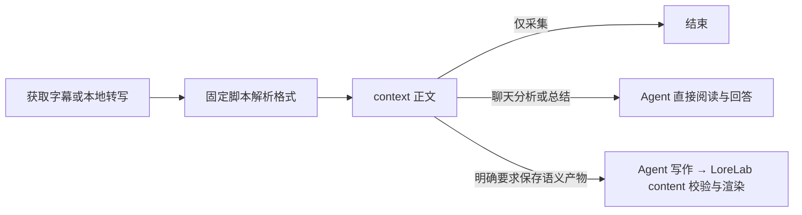

# 字幕格式与 context

treg 条目核对日期：2026-10-28；其余来源记录日期：2026-10-04。表中“工具能力”与“Soota 当前使用”分别列出；实际可取格式还取决于站点、版本和具体字幕轨道。

## 工具与格式

| 工具／来源 | 工具可提供的字幕表示或输出格式 | Soota 当前使用 |
| --- | --- | --- |
| OpenCLI：YouTube、Bilibili | JSON、YAML、CSV、Markdown 表格、终端表格，均为提取后片段的序列化输出 | 逐段 JSON；YouTube 使用 `--mode raw` |
| yt-dlp：YouTube | JSON3、SRV1、SRV2、SRV3、TTML、SRT、VTT | 按所选轨道可用格式取一份，首选 JSON3 |
| yt-dlp：Bilibili 普通视频 | 将 B站字幕 JSON 转为 SRT；另有弹幕 XML | SRT，排除弹幕 |
| TikHub：YouTube | JSON3、XML、SRT、TXT | SRT |
| treg：YouTube / Crawl4AI | start_s/duration_s/text 片段 JSON | `crawl4ai-youtube`，秒制时间 |
| treg：YouTube / ScrapeCreators | startMs/endMs/text 片段 JSON | `scrapecreators-youtube`，毫秒字符串；语言名称不能当语言代码 |
| Monid：YouTube / Apify | start/duration/text 片段 JSON | `youtube-transcript` |
| Monid：Bilibili / TikHub | 同 TikHub Bilibili | `bilibili-json` |
| TikHub：Bilibili | 字幕信息 JSON，以及字幕地址指向的 B站原生 JSON | 字幕 `body` JSON |
| Downie 4 | 默认 SRT；可设置保留站点原格式，官方没有列出固定的原始格式全集 | 未接入字幕采集，只作可选媒体／音频来源 |
| Whisper／MLX Whisper：本地生成 | JSON、SRT、VTT、TXT、TSV；Whisper 当前上游另有 JSONL | JSON 中的识别片段 |
| faster-whisper：本地生成 | Python 片段迭代器及识别信息；导出文件由调用方负责 | `start/end/text` 片段 |

OpenCLI 的 JSON 是它自己的行结构，不是 YouTube JSON3。它的 raw 表示逐段输出，不保证上游原始字节或全部字段原样保留。TikHub 的 API 外壳是 JSON，也不代表字幕正文格式就是 JSON；正文格式由接口参数和返回结构决定。语音识别模型生成文字属于转写，不是下载已有字幕。

来源：[OpenCLI 输出格式](https://github.com/jackwener/opencli#output-formats)、[YouTube 提取器](https://github.com/yt-dlp/yt-dlp/blob/master/yt_dlp/extractor/youtube/_video.py)、[Bilibili 提取器](https://github.com/yt-dlp/yt-dlp/blob/master/yt_dlp/extractor/bilibili.py)、[TikHub YouTube](https://docs.tikhub.io/431829301e0)、[TikHub Bilibili](https://docs.tikhub.io/420748831e0)、[Downie 字幕](https://software.charliemonroe.net/help/downie/?article=subtitles)、[Whisper 输出](https://github.com/openai/whisper/blob/main/whisper/transcribe.py)、[MLX Whisper](https://github.com/ml-explore/mlx-examples/blob/main/whisper/mlx_whisper/cli.py)、[faster-whisper](https://github.com/SYSTRAN/faster-whisper#usage)。

## 格式优先级

比较前提是同一视频、语言和字幕轨道，正文完整，而且当前解析器能正确处理该格式。格式偏好不改变 Provider 的优先级，也不要求重复获取已经成功取得的字幕。

| 优先级 | 格式 | 依据 |
| --- | --- | --- |
| 1 | 原生结构化字幕 JSON／JSON3 | 正文、时间和实际存在的附加字段明确，适合程序提取 |
| 2 | 已知结构的逐段 JSON，如 OpenCLI raw | 易解析，但可能已经删减上游字段 |
| 3 | VTT、TTML、SRV/XML | 可包含时间和说话人等标记，需按对应格式解析 |
| 4 | SRT | 正文和起止时间简单明确，附加信息通常较少 |
| 5 | 纯 TXT | 适合直接读文字，但时间轴和片段结构通常已丢失 |

这是采集格式的选择原则，不是转换器的处理顺序。yt-dlp 在获取前按所选轨道可用格式选择一份；转换层只处理实际取得的正文，失败时明确报错，不重复拉取其他格式。其他工具的请求格式仍以上表最后一列为准。`.json` 后缀本身没有优先权，必须是已知字幕结构。若 VTT/XML 比某个被裁剪的 JSON 保留更多相关信息，应优先更完整的结果。文件格式与人工／AI 字幕质量、原语言／翻译轨道是不同的选择维度。

## 统一转换层

整体黑盒流程及职责归属维护在 [处理流程与职责](providers.md#处理流程与职责)，本节维护实际解析能力。格式标识描述正文结构，与 Provider 名称无关；同样的 SRT/VTT 不论由谁获取都调用同一个解析器。

| 输入格式标识 | 当前支持范围 |
| --- | --- |
| `srt` | 字幕编号、毫秒时间、CRLF/BOM、多行正文、常见文字样式标签及实体 |
| `vtt` | 有／无 cue ID、毫秒时间、cue 设置、NOTE/STYLE/REGION、文字样式与内联时间标签；保留正文换行 |
| `ttml`、`dfxp` | 媒体时间轴、并行容器、嵌套 body/div/p、继承的 begin/end/dur、父级结束范围、时钟／小时／分钟／秒／毫秒／frame／tick、frameRateMultiplier、subFrameRate、br 与正文空白 |
| `srv1` | `transcript/text`，start/dur 为秒 |
| `srv2` | `timedtext/text`，t/d 为毫秒 |
| `srv3` | `timedtext/body/p`，t/d 为毫秒；读取 s 文本，保留有正文的 append 事件，忽略无正文窗口控制 |
| `xml` | 按以上已知 XML 结构识别 SRV 或 TTML；未知 XML、弹幕及 HTML 报错 |
| `json3` | YouTube events/segs；保留每个文字事件的顺序、重复与换行，不做滚动字幕去重 |
| `crawl4ai-youtube` | 秒制 start_s/duration_s 与 text；保留实际语言和可靠轨道类型 |
| `scrapecreators-youtube` | 毫秒制 startMs/endMs 与 text；无可靠语言代码、轨道类型时保留未知 |
| `youtube-transcript` | 秒制 start/duration 与 text 片段数组；不补造缺失结束时间 |
| `bilibili-json` | B站 body/from/to/content |
| `opencli-youtube`、`opencli-bilibili`、`opencli-mcp` | 各自明确的逐段 JSON 字段结构；保留未知的实际语言与轨道来源 |
| `whisper-json`、`whisper-jsonl` | Whisper/MLX/faster-whisper 识别片段；JSONL 每行一个片段，start/end 为秒 |
| `tsv` | Whisper start/end/text 三列，时间为毫秒 |
| `txt` | 完整原文；无时间轴，绝不填造时间 |
| `soota-segments` | 旧缓存及旧 ASR 扩展的已规范化片段兼容入口 |

这是文字与时间提取器，不是字幕视觉渲染器：不还原字体、位置、窗口滚动或动画。TTML 的 clock/smpte 时间基准、seq 容器、重复时序和段内动态 span 时间明确报不支持，避免输出错误的时间轴。SRV3 的段内 s 偏移不单独生成词级字幕。源文件缺少结束时间时保留未知结束时间；TXT 在 `transcript.md` 标记“无时间轴”，无法按时间范围过滤。

转换入口 `transcripts/conversion.py::parse_payload` 只接收格式与正文；`convert_captions` 处理获取状态。新增 Provider 使用已支持格式时只需返回 `CaptionAcquisition`，无需复制解析逻辑；新增格式时修改 `transcripts/formats/` 的对应 reader 与注册表，并补充格式契约测试。未知或损坏格式报 `ContractError`，不冒充没有字幕，也不据此触发 ASR 或付费回退。空正文按对应格式契约返回未知状态或格式错误，始终不记为无轨道。

VTT 使用 [webvtt-py](https://github.com/glut23/webvtt-py)，并校验其未覆盖的坏字幕块，防止静默漏掉正文。TTML 使用标准库 XML 解析并依据 [W3C TTML](https://www.w3.org/TR/ttml1/) 实现以上媒体时间子集；核对过的 [pycaption](https://github.com/pbs/pycaption/blob/main/pycaption/dfxp/reader.py) 和 [pysubs2](https://github.com/tkarabela/pysubs2/blob/master/pysubs2/formats/ttml.py) 不能直接满足本项目的父级时间继承与 frame/tick 组合需求。SRV 结构参考 [RustyPipe](https://docs.rs/rustypipe/latest/src/rustypipe/model/mod.rs.html) 与 [YTSubConverter](https://github.com/arcusmaximus/YTSubConverter/blob/master/YTSubConverter.Shared/Formats/YttDocument.cs)。

工具输出的 YAML、CSV、Markdown 表格或终端表格是其自身行数据的展示方式；OpenCLI 获取端统一请求 JSON，不把这些展示输出冒充新的原生字幕格式。这里没有增加任意本地文件导入命令。

## 默认交付 context

`ingest` 默认保存：

- `context.md`：面向 Agent 的正文。按规范化字幕片段的原顺序输出，保留片段 ID、原文、重复和断句；不合并段落、不修辞、不纠错、不补写，也不插入摘要占位。
- `transcript.md`：保留片段 ID 和来源实际存在的毫秒时间轴，供引用核对；没有时间时明确标记未知。精度以来源为限，旧秒格式不能恢复此前已丢失的小数信息。
- `manifest.json`：来源、字幕状态、处理记录和文件索引；未请求分析时标记 `analysis.status=not_requested`，旧分析字段只作数据兼容。

已有的明确过滤选项在 context 生成之前生效；启用推广过滤时仍保留 `transcript.original.md`。context 忠实于交给 Soota 的规范化片段，不承诺恢复上游已经删掉的字段。

单纯采集到 context 就结束。分析／总结任务可以直接使用 context，不先生成长文章。只有用户明确要求详细阅读文章时，才由 Agent 重组、润色和组织文章；需要保存语义产物时通过 LoreLab content 提交。固定脚本不承担这种语义处理，CLI 也不会自动读取提示词并调用语言模型。

新视频内容包的 JSON 返回 `data.context`；`ingest` 的旧 `data.content` 暂作兼容别名，指向同一个 context 文件。`catalog` 的 `data.content` 仍指向目录文件，不受此规则影响。旧包没有 context 时，Agent 读取 `transcript.md`，不把旧文章当作源正文。

## 可选阅读与分析产物

`content.md` 仅作为显式阅读／分析输出，由 LoreLab content 保存。标准分析和自定义文章的 schema 与写作指导在 LoreLab Skill 维护；新操作使用 `lorelab content render --bundle PATH --analysis PATH`，旧 `soota render` 只作隐藏兼容桥。独立 Soota 未安装 LoreLab 时明确报需要安装且不修改任务或产物；普通采集不受影响。

LoreLab content 的 `render` 不修改 context、字幕或过滤前原文；覆盖已有 `content.md` 需显式 `--force`。重新 `ingest` 即使使用 `--force` 也不会顺带改写旧文章；来源片段变化时只将已有分析标记为 `stale`。再次采集未取得可用正文时，默认返回 `source_preserved` 并保留已有有效源文件，不把旧内容冒充新采集成功的结果。
